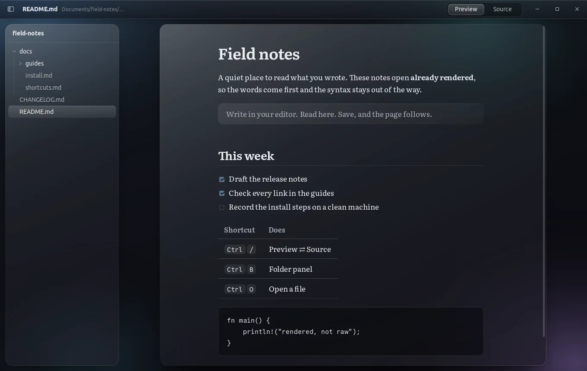

# mdlens

**Markdown, already rendered.** mdlens is a small dark-glass viewer for `.md` files on Ubuntu, with a Windows preview. Double-click a file and you are reading it, not its syntax. The source is one key away.

[Website](https://tanim913.github.io/mdlens/) · [Download](https://github.com/tanim913/mdlens/releases/latest)



## Features

- **Opens rendered.** Tables, task lists, footnotes, code blocks, heading anchors and local images (GitHub-flavoured Markdown).
- **Source on `Ctrl` + `/`.** A read-only source view with line numbers.
- **Live reload.** Save the file in any editor and the page updates in place, keeping your scroll position.
- **Folders.** Open a folder to get a collapsible panel of its Markdown files, starting at the README. A single file opens without the panel.
- **Safe with untrusted files.** Raw HTML in Markdown stays escaped. Web links open in your browser; relative `.md` links open in mdlens.
- **Works on every Ubuntu.** One `.deb` for Ubuntu 20.04, 22.04, 24.04 and newer. mdlens carries its own browser engine (Electron), so it does not depend on whichever WebKit your release ships. The cost is size: about 100 MB to download.
- **One window.** Opening another file from the file manager reuses the window that is already open. The only network access is for remote images in the file itself.

## Install

Ubuntu 20.04, 22.04, 24.04 or newer (64-bit):

```sh
wget https://github.com/tanim913/mdlens/releases/latest/download/mdlens_0.2.0_amd64.deb
sudo apt install ./mdlens_0.2.0_amd64.deb
xdg-mime default mdlens.desktop text/markdown   # open .md files with mdlens by default
```

mdlens then also appears in the file manager's **Open With** menu for Markdown files and for folders. Installing 0.2.0 over 0.1.0 upgrades it in place.

Windows 10 or 11 (64-bit, untested so far): download [mdlens-0.2.0-setup.exe](https://github.com/tanim913/mdlens/releases/latest/download/mdlens-0.2.0-setup.exe) and run it. The installer is not code-signed, so SmartScreen shows "Windows protected your PC": choose **More info**, then **Run anyway**. mdlens installs for your user only and registers itself for `.md` files; pick it under **Open with** to make it the default.

## Usage

```sh
mdlens notes.md      # open a file
mdlens ~/docs        # open a folder with the file panel
```

| Keys | Action |
|---|---|
| `Ctrl` `/` | Preview or Source |
| `Ctrl` `O` | Open a file |
| `Ctrl` `Shift` `O` | Open a folder |
| `Ctrl` `B` | Show or hide the folder panel |
| `Ctrl` `+` / `-` / `0` | Zoom |

You can also drop a file or a folder onto the window.

## Build from source

Needs Node.js 20 or newer.

```sh
git clone https://github.com/tanim913/mdlens.git && cd mdlens
npm ci
npm start            # run it from the source folder
npm test             # renderer and folder-tree tests
npm run dist         # builds dist/mdlens_0.2.0_amd64.deb
```

The app is Electron with plain HTML, CSS and JavaScript in `ui/`. The Markdown is rendered with [markdown-it](https://github.com/markdown-it/markdown-it) (`core.js`), and `main.js` handles the window, files and live reload.

Version 0.1.0 was built with Rust and Tauri 1. That build needs `libwebkit2gtk-4.0`, which Ubuntu 24.04 and later no longer ship, so 0.2.0 moved to Electron. The interface is unchanged.

## Limits

- Built and tested on Ubuntu 20.04. The package depends only on libraries that 22.04 and 24.04+ ship, and on 24.04+ it installs an AppArmor profile so Chromium's sandbox works under the newer rules.
- The Windows build comes from CI and has not been tested on a Windows machine yet. No macOS release.
- Viewer only: no editing, tabs, search or table of contents.
- The folder panel is read when the folder opens; files added later appear after reopening it.

## License

MIT, see [LICENSE](LICENSE). The bundled fonts, [Literata](https://github.com/googlefonts/literata) and [Commit Mono](https://github.com/eigilnikolajsen/commit-mono), are under the SIL Open Font License; their licences are in `ui/fonts/`.
